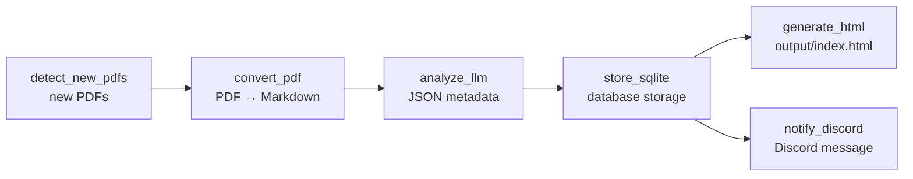

# Paper Pipeline

An Apache Airflow pipeline that turns research papers in PDF format into a searchable library. A scheduled DAG detects new PDFs dropped into a Google Drive folder, converts them to Markdown, prompts a local LLM (Ollama) to extract the title, summary, keywords, and category, stores this metadata in SQLite, regenerates an HTML page with search and category filtering, and sends a Discord notification.

Project built for Assignment 3 of the course INFO-H420 *Process Modeling, Data Pipelines, and Responsible AI* (ULB).

## How It Works



| Task | What it does |
|---|---|
| `detect_new_pdfs` | Lists PDFs in the `papers/` folder that are not yet in the database |
| `convert_pdf` | Converts the first 3 pages of the PDF to Markdown using PyMuPDF4LLM |
| `analyze_llm` | Sends the Markdown to the local LLM and retrieves the title, summary, keywords, and category in JSON |
| `store_sqlite` | Saves the record in `data/papers.db` (one row per file) |
| `generate_html` | Regenerates `index.html` from the entire database |
| `notify_discord` | Sends a Discord message for each new paper |

`convert_pdf`, `analyze_llm`, `store_sqlite`, and `notify_discord` are created dynamically, with one instance per PDF (*dynamic task mapping*). PDFs already present in the database are never reprocessed: re-running the DAG will not create duplicates.

The PDFs and the HTML page are stored in Google Drive. The SQLite database remains on the local machine, outside the synced folder.

## Prerequisites

- macOS or Linux. On Windows, Airflow requires WSL2.
- Python 3.10 to 3.14 (tested with Python 3.12).
- [Ollama](https://ollama.com) with the `llama3.1` model (approx. 5 GB; 8 GB of RAM minimum).
- [Google Drive for desktop](https://www.google.com/drive/download/).
- A Discord webhook. This is optional: without a URL, the notification is simply skipped.

## Installation

```bash
git clone https://github.com/quanghuyngn2/paper-pipeline.git
cd paper-pipeline

python3.12 -m venv .venv
source .venv/bin/activate

# Airflow is installed using a constraints file, which pins versions tested together
AIRFLOW_VERSION=3.3.2
PYTHON_VERSION=3.12
pip install "apache-airflow==${AIRFLOW_VERSION}" \
  --constraint "https://raw.githubusercontent.com/apache/airflow/constraints-${AIRFLOW_VERSION}/constraints-${PYTHON_VERSION}.txt"

pip install -r requirements.txt

ollama pull llama3.1
```

## Configuration

### 1. Google Drive Folders

In **My Drive**, create a `ResearchLibrary` folder containing two subfolders: `papers` and `output`. In Finder, right-click `ResearchLibrary` and select **Make available offline** so that the PDFs are already stored locally when the pipeline reads them.

### 2. The `.env` File

```bash
cp .env.example .env
```

Then fill in `.env`:

| Variable | Role | Example |
|---|---|---|
| `PAPERS_DIR` | Drive folder where PDFs are dropped | `"/Users/<you>/Library/CloudStorage/GoogleDrive-<email>/My Drive/ResearchLibrary/papers"` |
| `OUTPUT_DIR` | Drive folder where the HTML page is written | `"/Users/<you>/Library/CloudStorage/GoogleDrive-<email>/My Drive/ResearchLibrary/output"` |
| `DB_PATH` | SQLite database, outside Drive (relative to project root) | `data/papers.db` |
| `OLLAMA_BASE_URL` | Ollama's OpenAI-compatible API address | `http://localhost:11434/v1` |
| `OLLAMA_MODEL` | Model used | `llama3.1` |
| `DISCORD_WEBHOOK_URL` | Discord channel webhook | `https://discord.com/api/webhooks/...` |

Watch out for file paths:

- **Wrap full paths in quotes** because of the space in "My Drive" (or "Mon Drive" depending on your Google Drive locale).
- **Do not leave any `\` in them.** Dragging a folder into the terminal produces `My\ Drive`: inside quotes, the backslash becomes a literal character in the path and the folder will not be found. To get the exact path, right-click the folder, select **New Terminal at Folder**, and run `pwd`.
- **Do not leave `PAPERS_DIR` or `OUTPUT_DIR` empty**: an empty path resolves to Airflow's current working directory.

The `.env` file contains the secret webhook URL: it is excluded from Git via `.gitignore` and must never be pushed.

## Running the Pipeline

1. Start Ollama (menu bar icon on macOS, or `ollama serve` on Linux).
2. From the project root, start Airflow:

   ```bash
   ./start.sh
   ```

   If the terminal answers `permission denied`, run `chmod +x start.sh` once, then try again.

   The script activates `.venv`, sets the environment variables Airflow needs, then runs `airflow standalone`. It is equivalent to:

   ```bash
   source .venv/bin/activate
   export AIRFLOW_HOME=~/airflow
   export AIRFLOW__CORE__DAGS_FOLDER="$(pwd)/dags"   # reads the DAG directly from the project
   export AIRFLOW__CORE__LOAD_EXAMPLES=False         # hides example DAGs
   export PYTHONPATH="$(pwd)"                        # allows the DAG to import the pipeline package
   export NO_PROXY="*"                               # macOS: prevents network task crashes
   airflow standalone
   ```

   If you run these commands by hand, note that `export` only applies to the current terminal session: run them again each time you start Airflow. Either way, the terminal then remains occupied by Airflow—leave it open.

3. Open <http://localhost:8080> and log in with the user `admin`. The password is printed in the terminal; otherwise, run:

   ```bash
   cat ~/airflow/simple_auth_manager_passwords.json.generated
   ```

4. Enable the `paper_pipeline` DAG using its toggle switch: new DAGs are paused by default.
5. Drop PDFs into `ResearchLibrary/papers`.
6. Wait for the next scheduled run (daily at 8:00 AM Brussels time), or run it immediately using the **Trigger** button.

Outputs:

- The `ResearchLibrary/output/index.html` page, ready to open in a browser;
- The `data/papers.db` database: `sqlite3 data/papers.db "SELECT filename, title, category FROM papers"`;
- One Discord message per new paper.

To stop Airflow, press **Ctrl + C** in its terminal.

## Testing Without Airflow

Each component can be tested independently from the project root with `.venv` activated:

```bash
# Convert a PDF and extract its metadata (Ollama must be running)
python -m pipeline.pdf_llm path/to/paper.pdf

# Test SQLite, HTML generation, and Discord on a temporary database
python test_outputs.py
```

`test_outputs.py` sends a test message to Discord if `DISCORD_WEBHOOK_URL` is set.

## Project Structure

```
paper-pipeline/
├── dags/
│   └── paper_pipeline.py   # Airflow DAG: tasks, dependencies, scheduling
├── pipeline/
│   ├── config.py           # reads .env (paths, model, webhook)
│   ├── pdf_llm.py          # PDF → Markdown, metadata extraction via LLM
│   └── outputs.py          # SQLite, HTML page, Discord notification
├── test_outputs.py         # tests outputs.py without Airflow
├── start.sh                # starts Airflow with the right configuration
├── requirements.txt
└── .env.example            # configuration template, copy to .env
```

The `data/` directory, which holds the SQLite database, is created automatically and ignored by Git.

## Notes

- **Only one machine should run the pipeline** on a shared Drive folder. Each machine maintains its own database: running two pipelines concurrently would process every PDF twice.
- **Scanned PDFs**, lacking a text layer, are rejected with an explicit error. A failing PDF does not block other PDFs or prevent the HTML page from updating.
- **To reprocess everything**, delete `data/papers.db`: all PDFs will be treated as new on the next run.

## Authors

Quang Huy, Laurie, and Alvaro — INFO-H420, ULB, 2026–2027.